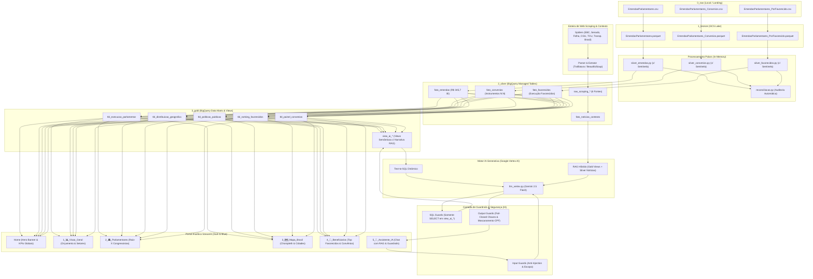

# Projeto de Análise de Emendas Parlamentares (ETL no GCP)


Pipeline de Engenharia de Dados e Inteligência Analítica de ponta a ponta para extração, tratamento, modelagem, enriquecimento qualitativo e visualização dos dados abertos de **Emendas Parlamentares do Brasil**, utilizando a plataforma **Google Cloud Platform (GCP)** com processamento colunar em memória via **Polars**, esteira de **Web Scraping** de notícias e observatórios, motor generativo **Vertex AI (Gemini)** com Text-to-SQL + RAG Híbrido e portal analítico interativo em **Streamlit**.

> **Status atual:** camadas **Raw**, **Bronze**, **Silver** (fatos com sentinelas para preservação integral de R$ 345,74 Bi e reconciliação automática), **Web Scraping na Silver** (coleta das 6 fontes, tabelas brutas `raw_scraping_*` e consolidação em `fato_noticias_contexto`), **Gold** (5 Data Marts físicos + 5 Views Semânticas com metadados para IA), **Motor Vertex AI (Gemini Text-to-SQL e RAG Híbrido)**, **Guardrails de Segurança (Fail-Closed)** e **Portal Analítico Streamlit (Design System Dark & Blue com 5 Dashboards)** implementados e validados com **101 testes automatizados**.

---

## 🎯 Objetivo

Construir um pipeline ETL/ELT e produto de dados de ponta a ponta seguindo o padrão **Medallion Architecture**:
1. **Raw (0_raw)**: Ingestão de dados brutos tabulares em formato CSV (`ISO-8859-1` / `UTF-8`).
2. **Bronze (1_bronze)**: Conversão para formato colunar Parquet em memória, sanitização de cabeçalhos (`snake_case`), injeção de metadados de auditoria (`_ingestion_timestamp` e `_source_file`) e arquivamento no **Google Cloud Storage (GCS)**.
3. **Silver (2_silver)**: Modelagem analítica em tabelas fato, preservação total de registros históricos e especiais via código sentinela (`-1`), engenharia de atributos geográficos e temporais, reconciliação automatizada e carga direta em **tabelas nativas gerenciadas no BigQuery**:
   - `fato_emendas`: Fato orçamentária consolidando dotações das emendas com 6 métricas monetárias (empenhado, liquidado, pago, restos a pagar inscritos/cancelados/pagos), autor, ano, classificação funcional e localização.
   - `fato_convenios`: Fato analítica tratando a relação $N:N$ entre emendas e instrumentos contratuais com valores alocados.
   - `fato_favorecidos`: Fato periódica mensal de transferências e pagamentos diretos por favorecido (CNPJ/CPF/Órgão).
4. **Web Scraping & Contexto Qualitativo (2_silver)**: Esteira automatizada de spiders para captura de matérias jornalísticas, fiscalizações e relatórios cívicos das 6 principais fontes oficiais (EBC, Agência Senado, Folha de S.Paulo, TCU, CGU e Transparência Brasil), persistindo o lote bruto em `2_silver.raw_scraping_*` e estruturando a tabela unificada para RAG em `2_silver.fato_noticias_contexto`.
5. **Gold (3_gold)**: Data Marts analíticos em SQL materializados no **Google BigQuery** e camada de **Views Semânticas** preparadas para consumo humano e agentes de Inteligência Artificial:
   - 5 Data Marts físicos: `tbl_execucao_parlamentar`, `tbl_distribuicao_geografica`, `tbl_politicas_publicas`, `tbl_ranking_favorecidos` e `tbl_painel_convenios`.
   - 5 Views Semânticas: `view_ai_*` providas de colunas pré-formatadas (`*_BRL`, `*_PCT`), metadados `OPTIONS(description=...)` e resumos em linguagem natural para RAG (`DS_RESUMO_SEMANTICO`).
6. **Motor de Inteligência Artificial Generativa (Vertex AI / Gemini)**: Motor Text-to-SQL dinâmico com RAG híbrido (`app/utils/llm_vertex.py`) integrando os dados quantitativos oficiais das views Gold e o acervo qualitativo de notícias da Silver, com capacidade de síntese explicativa e resposta a perguntas analíticas em linguagem natural.
7. **Segurança & Guardrails para IA**: Módulos defensivos com validação de entrada (*input guards* anti-prompt injection e jailbreak), restrição estrita a comandos `SELECT` em views autorizadas (*sql guards*) e prioridade máxima *Fail-Closed* na detecção de credenciais com mascaramento de PII (*output guards*).
8. **Portal Analítico Streamlit**: Aplicação web multi-páginas com Design System Dark/Blue moderno (`#0A0E17`, `#151C2C`, `#38BDF8`), cards de métricas uniformes, gráficos interativos Plotly e assistente conversacional inteligente.

---

## 🏗️ Arquitetura de Dados



---

## 🧭 Decisões de Projeto e Status

| Tema | Decisão | Status |
|---|---|---|
| **Processamento** | Polars, pelo processamento colunar ultra-rápido e baixo uso de memória nas transformações analíticas. | Implementado |
| **Volume e tempo** | Conversão para Parquet de ~20 MB em média; pipeline completo executado em ~2 minutos com zero spill em disco. | Medido |
| **Bronze** | Parquet (Snappy) arquivado no GCS com isolamento de dados brutos e auditoria temporal. | Implementado |
| **Silver** | Tabelas nativas gerenciadas no BigQuery com ingestão direta e tipagem estrita de colunas monetárias e datas. | Implementado |
| **Sentinelas & Qualidade** | Substituição do descarte de registros sem código por código sentinela (`-1`) e indicador booleano (`codigo_emenda_informado`), recuperando **100% dos empenhos (R$ 345,74 Bi)** na Silver. | Implementado |
| **Reconciliação** | Módulo automático (`reconciliacao.py`) que audita a consistência volumétrica e financeira entre Bronze e Silver a cada execução. | Implementado |
| **Convênios (N:N)** | Grão da fato_convenios definido como `[numero_convenio × codigo_emenda]`. Na Gold, a agregação prévia deduplica o instrumento para prevenir sobreposição contábil. | Implementado |
| **Favorecidos** | Granularidade mensal, acompanhando a evolução dos repasses ao longo do exercício fiscal. | Implementado |
| **Gold (Data Marts)** | 5 tabelas analíticas materializadas no BigQuery para alta performance em consultas de dashboard. | Implementado |
| **Views Semânticas para IA** | 5 views semânticas (`view_ai_*`) enriquecidas com `OPTIONS(description=...)`, campos pré-formatados e texto narrativo para RAG (`DS_RESUMO_SEMANTICO`). | Implementado |
| **Web Scraping** | Esteira completa com spiders para 6 fontes públicas, gravação particionada bruta na Silver (`raw_scraping_*`) e fato unificada (`fato_noticias_contexto`). | Implementado |
| **Motor Vertex AI (Gemini)** | Text-to-SQL dinâmico e RAG híbrido contextualizando dados oficiais e artigos jornalísticos com respostas em linguagem natural. | Implementado |
| **Guardrails de Segurança** | Proteção tripla do assistente contra injeção de prompt, execução destrutiva em SQL e vazamento de chaves ou PII (*Fail-Closed*). | Implementado |
| **Portal Streamlit** | 5 dashboards interativos e assistente com design system Dark/Blue moderno (`#0A0E17`, `#151C2C`, `#38BDF8`) e cartões padronizados. | Implementado |
| **Testes** | **101 testes automatizados** com mocks de GCS/BigQuery cobrindo pipeline, transformações, camada Gold, views de IA, guardrails, scraping e helpers de UI. | Implementado (Green) |

---

### 📊 Reconciliação de Integridade entre Camadas (Bronze ➔ Silver com Sentinelas)

> [!IMPORTANT]
> **Data de Referência dos Dados:** Arquivos brutos extraídos do Portal da Transparência em **28/08/2026**.  
> **Garantia de Integridade:** Com a implementação das regras sentinelas, **nenhum valor financeiro é expurgado** da `fato_emendas`, mantendo a conciliação total de **R$ 345,74 Bilhões** com o Portal da Transparência.

| Entidade | Linhas Bronze (Bruto) | Linhas Silver (Fato) | Código Sentinela (`-1`) | % Linhas Sentinela | Valor Financeiro Bronze | Valor Financeiro Silver | % Valor Preservado |
|---|:---:|:---:|:---:|:---:|:---:|:---:|:---:|
| **Emendas** (`fato_emendas`) | 94.463 | 94.463 | 17.810 | 18,85% | R$ 345,74 Bi (Empenhado) | R$ 345,74 Bi (Empenhado) | **100,00%** |
| **Convênios** (`fato_convenios`) | 85.104 | 85.023* | 9.156 | 10,77% | R$ 121,41 Bi (Conveniado) | R$ 120,99 Bi (Conveniado) | **99,68%** |
| **Favorecidos** (`fato_favorecidos`) | 820.690 | 820.690 | 67.039 | 8,17% | R$ 280,38 Bi (Pago) | R$ 280,32 Bi (Pago) | **100,00%** |

*\* A discreta diferença em convênios refere-se a deduplicações estritas de instrumentos tratadas sem qualquer prejuízo à granularidade do instrumento.*

---

## ⚙️ Stack Tecnológica

- **Linguagem & Processamento:** Python 3.12, [Polars](https://pola.rs/) (processamento colunar vetorizado em memória) e [Pandas](https://pandas.pydata.org/).
- **Nuvem & Armazenamento (GCP):**
  - **Google Cloud Storage (GCS):** Data Lake Bronze (arquivos colunares Parquet Snappy).
  - **Google BigQuery:** Data Warehouse corporativo (camadas Silver e Gold nativas).
- **Inteligência Artificial Generativa:** [Google GenAI SDK](https://github.com/google/generative-ai-python) com **Gemini 2.5 Flash** no Google Vertex AI.
- **Web Scraping & Extração de Texto:** `httpx`, `tenacity` (resiliência com backoff exponencial), `trafilatura` e `beautifulsoup4`.
- **Frontend & Visualização:** [Streamlit](https://streamlit.io/) com tema Dark & Blue customizado e [Plotly](https://plotly.com/python/).
- **Gerenciador de Ambientes & Pacotes:** [uv](https://docs.astral.sh/uv/) (lockfile reproduzível).
- **Linter & Formatador:** [Ruff](https://docs.astral.sh/ruff/) (regras de estilo e limite de 120 caracteres).
- **Testes Automatizados:** [Pytest](https://pytest.org/) com mocks completos de APIs GCP e fixtures determinísticas.

---

## 📂 Estrutura do Projeto

```text
projeto_emendas/
├── .github/workflows/
│   └── ci_cd.yml                              # Pipeline de CI/CD (Ruff + Pytest)
├── pyproject.toml                             # Metadados, dependências, ruff e pytest configs
├── uv.lock                                    # Lockfile reproduzível do uv
├── .env                                       # Variáveis de ambiente (ignorado no git)
├── .streamlit/
│   └── config.toml                            # Configuração de tema Dark & Blue
├── docs/                                      # Especificações técnicas e planos arquiteturais
│   ├── plano_implementacao_streamlit.md       # Diretrizes de UI/UX, paleta Dark & Blue e telas
│   └── plano_implementacao_scraping.md        # Arquitetura das 6 fontes de scraping na Silver
├── app/                                       # Aplicação Web Streamlit (Multi-páginas)
│   ├── Home.py                                # Ponto de entrada, Hero Banner e KPIs macro
│   ├── guardrails/                            # Bridge para validação e segurança da interface IA
│   ├── utils/                                 # Utilitários de apoio do frontend
│   │   ├── db.py                              # Conexão e cache BigQuery (@st.cache_data)
│   │   ├── formatters.py                      # Formatação monetária (BRL), percentuais e documentos
│   │   ├── llm_vertex.py                      # Motor IA Vertex (Gemini Text-to-SQL + RAG Híbrido)
│   │   └── styles.py                          # Design System Dark/Blue, métricas uniformes e CSS
│   └── pages/
│       ├── 1_📊_Visao_Geral.py                # Macro-orçamento, tendências temporais e funções
│       ├── 2_🏛️_Parlamentares.py               # Raio-X por congressista, taxas de execução e RAP
│       ├── 3_🗺️_Mapa_Brasil.py                 # Distribuição regional/estadual e mapa coroplético
│       ├── 4_🏢_Beneficiarios.py               # Maiores recebedores, CNPJs e convênios federais
│       └── 5_🤖_Assistente_IA.py               # Chat inteligente com RAG, Text-to-SQL e acervo Silver
├── database/                                  # Dados brutos CSV locais (Portal da Transparência)
├── database_sample/                           # Amostras reduzidas para execução de testes em CI
├── data/
│   ├── bronze/                                # Parquets intermediários gerados da camada Bronze
│   ├── silver/                                # Parquets gerados da Silver (fato_emendas, convenios, favorecidos)
│   └── gold/                                  # Diretório reservado para artefatos da Gold
├── sql/
│   └── gold/                                  # Scripts SQL dos Data Marts e Views Semânticas de Consumo
│       ├── gold_execucao_parlamentar.sql      # Data Mart físico de parlamentares
│       ├── gold_distribuicao_geografica.sql   # Data Mart físico de geografia
│       ├── gold_politicas_publicas.sql        # Data Mart físico de funções orçamentárias
│       ├── gold_ranking_favorecidos.sql       # Data Mart físico de favorecidos
│       ├── gold_painel_convenios.sql          # Data Mart físico de convênios
│       ├── view_ai_execucao_parlamentar.sql   # View Semântica IA c/ campos BRL e narrativa RAG
│       ├── view_ai_distribuicao_geografica.sql# View Semântica IA c/ campos BRL e narrativa RAG
│       ├── view_ai_politicas_publicas.sql     # View Semântica IA c/ campos BRL e narrativa RAG
│       ├── view_ai_ranking_favorecidos.sql    # View Semântica IA c/ campos BRL e narrativa RAG
│       └── view_ai_painel_convenios.sql       # View Semântica IA c/ campos BRL e narrativa RAG
├── notebooks/
│   └── projeto_inicial.ipynb                  # Explorações analíticas preliminares
├── src/
│   └── etl_emendas_parlamentares/
│       ├── __init__.py
│       ├── pipeline.py                        # Orquestração do pipeline ponta a ponta
│       ├── config/
│       │   └── config.py                      # Definições de caminhos, datasets e prefixos
│       ├── conexao/
│       │   └── big_query.py                   # Conexão autenticada ao BigQuery e Storage via Service Account
│       ├── guardrails/                        # Módulos de segurança e validação do agente
│       │   ├── __init__.py
│       │   ├── input_guards.py                # Filtros contra prompt injection e jailbreak
│       │   ├── sql_guards.py                  # Restrição a SELECT nas views semânticas autorizadas
│       │   ├── output_guards.py               # Fail-Closed para credenciais e mascaramento CPF
│       │   └── README.md                      # Documentação dos guardrails
│       ├── ingestao/
│       │   ├── upload_bronze.py               # Ingestão de arquivos Parquet no GCS
│       │   ├── upload_silver.py               # Carga direta em tabelas nativas gerenciadas no BigQuery
│       │   └── upload_gold.py                 # Orquestração e materialização dos Data Marts Gold
│       ├── processamento/
│       │   ├── csv_parquet.py                 # Conversão de CSV para Parquet com injeção de auditoria
│       │   ├── normalizar.py                  # Normalização de nomes de colunas (snake_case)
│       │   ├── reconciliacao.py               # Relatórios automatizados de auditoria entre camadas
│       │   ├── silver_emendas.py              # Modelagem da fato_emendas com sentinelas
│       │   ├── silver_convenios.py            # Modelagem N:N da fato_convenios com sentinelas
│       │   └── silver_favorecidos.py          # Modelagem periódica da fato_favorecidos com sentinelas
│       └── scraping/                          # Esteira de Web Scraping & Contexto Qualitativo
│           ├── __init__.py
│           ├── client.py                      # Cliente HTTP resiliente com Tenacity e rotação de headers
│           ├── fontes.py                      # Catálogo das fontes oficiais e observatórios cívicos
│           ├── parser.py                      # Higienização de HTML, extração de texto e metadados
│           ├── carga_silver_raw.py            # Carga bruta particionada (2_silver.raw_scraping_*)
│           ├── processar_contexto.py          # Consolidação de NLP (2_silver.fato_noticias_contexto)
│           ├── pipeline_scraping.py           # Orquestrador da esteira de scraping
│           └── spiders/                       # Extratores específicos por portal
│               ├── spider_cgu.py              # Spider CGU (Fiscalizações e Auditorias)
│               ├── spider_ebc.py              # Spider Agência Brasil / EBC
│               ├── spider_folha.py            # Spider Folha de S.Paulo
│               ├── spider_senado.py           # Spider Agência Senado
│               └── spider_transp_brasil.py    # Spider Transparência Brasil
└── tests/
    ├── conftest.py                            # Fixtures e configurações globais do Pytest
    ├── test_app_utils.py                      # Testes dos utilitários de formatação, cache e motor IA
    ├── test_csv_parquet.py                    # Testes de conversão CSV -> Parquet
    ├── test_guardrails.py                     # Testes dos guardrails de entrada, SQL e saída
    ├── test_normalizar.py                     # Testes de sanitização de strings e colunas
    ├── test_pipeline.py                       # Testes de orquestração do pipeline completo
    ├── test_reconciliacao.py                  # Testes do gerador de auditoria e métricas
    ├── test_scraping.py                       # Testes de spiders, parsing e carga de notícias
    ├── test_silver_convenios.py               # Testes da transformação de fato_convenios
    ├── test_silver_emendas.py                 # Testes da transformação de fato_emendas
    ├── test_silver_favorecidos.py             # Testes da transformação de fato_favorecidos
    ├── test_upload_bronze.py                  # Testes de envio para o Cloud Storage
    ├── test_upload_silver.py                  # Testes de carga nativa no BigQuery
    ├── test_upload_gold.py                    # Testes de orquestração e execução da Gold
    └── test_views_semanticas.py               # Testes de integridade, DDL e metadados das views de IA
```

---

## 🔑 Variáveis de Ambiente (`.env`)

Crie um arquivo `.env` na raiz do projeto com as seguintes variáveis:

```dotenv
GCP_PROJECT_ID="seu-projeto-gcp-id"
GCS_BUCKET_NAME="gs://seu-bucket-landing"
GOOGLE_APPLICATION_CREDENTIALS="gcp-credentials.json"
VERTEX_MODEL_NAME="gemini-2.5-flash"
GCP_LOCATION="global"
```

> [!IMPORTANT]
> O arquivo `gcp-credentials.json` e o `.env` contêm credenciais confidenciais e estão protegidos pelo `.gitignore` para nunca serem versionados.

---

## 🚀 Como Executar

### 1. Preparação do Ambiente Local com `uv`

1. Instale o [uv](https://docs.astral.sh/uv/):
   ```bash
   pip install uv
   # ou via winget (Windows): winget install astral-sh.uv
   ```
2. Instale as dependências e crie o ambiente virtual automaticamente:
   ```bash
   uv sync
   ```

### 2. Execução dos Testes e Validação de Código

- Rodar suíte completa de testes automatizados (**101 testes**):
  ```bash
  uv run --no-sync pytest
  ```
- Rodar o linter:
  ```bash
  uv run --no-sync ruff check .
  ```
- Verificar a formatação do código:
  ```bash
  uv run --no-sync ruff format --check .
  ```

### 3. Execução do Pipeline de Dados

- **Executar Pipeline Completo (Raw -> Bronze -> Silver -> Gold + Auditoria)**:
  ```bash
  uv run python src/etl_emendas_parlamentares/pipeline.py
  ```

- **Executar Esteira de Web Scraping & Contexto Qualitativo**:
  ```bash
  uv run python src/etl_emendas_parlamentares/scraping/pipeline_scraping.py
  ```

- **Gerar Relatório de Reconciliação e Auditoria**:
  ```bash
  uv run python src/etl_emendas_parlamentares/processamento/reconciliacao.py
  ```

### 4. Execução do Portal Streamlit

Para iniciar o portal interativo multi-páginas:

```bash
uv run streamlit run app/Home.py
```

O aplicativo estará acessível localmente em `http://localhost:8501`.

---

## 🗺️ Roadmap de Evolução

- [x] **Camada Bronze (1_bronze):** Ingestão, auditoria e arquivamento colunar Parquet no Google Cloud Storage (GCS).
- [x] **Camada Silver (2_silver) - fatos:** `fato_emendas`, `fato_convenios` e `fato_favorecidos` carregadas como tabelas nativas no BigQuery.
  - [x] **Preservação Integral via Sentinelas:** Atribuição de sentinela (`codigo_da_emenda = -1`, `codigo_emenda_informado = false`), assegurando 100% dos empenhos (R$ 345,74 Bi) e dados históricos.
  - [x] **Automatização da Reconciliação:** Módulo `reconciliacao.py` que gera auditorias tabulares automáticas a cada ciclo.
- [x] **Camada de Web Scraping & Contexto na Silver:**
  - [x] Spiders automatizados para 6 fontes públicas (EBC, Senado, Folha, CGU, TCU, Transparência Brasil).
  - [x] Carga bruta particionada em tabelas nativas (`2_silver.raw_scraping_*`).
  - [x] Consolidação analítica e NLP em tabela única para RAG (`2_silver.fato_noticias_contexto`).
- [x] **Camada Gold (3_gold):**
  - [x] Definição arquitetural dos 5 Data Marts analíticos via SQL no BigQuery.
  - [x] Scripts analíticos compilados e testados (`tbl_execucao_parlamentar`, `tbl_distribuicao_geografica`, `tbl_politicas_publicas`, `tbl_ranking_favorecidos`, `tbl_painel_convenios`).
  - [x] Módulo runner de orquestração (`upload_gold.py`) integrado ao `pipeline.py`.
  - [x] **Views Semânticas para IA (`view_ai_*`):** Metadados descritivos em `OPTIONS`, colunas formatadas em BRL/percentual e resumos sintéticos para RAG (`DS_RESUMO_SEMANTICO`).
  - [x] Suíte de testes automatizados para integridade das views de IA (`test_views_semanticas.py`).
- [x] **Segurança & Guardrails do Agente:**
  - [x] Filtros heurísticos de entrada (anti-prompt injection, detecção de jailbreak, limitação de payload).
  - [x] Guardrails de SQL (validação restrita de `SELECT` exclusivo nas views `view_ai_*`).
  - [x] Anonimização e mascaramento de saída (*Fail-Closed* para credenciais e redação de CPFs).
- [x] **Consumo Inteligente (Google Vertex AI / Gemini):**
  - [x] Motor de Text-to-SQL dinâmico convertendo linguagem natural em consultas analíticas BigQuery.
  - [x] RAG Híbrido integrando dados oficiais da Gold com acervo de notícias e contexto da Silver.
- [x] **Visualização Analítica Interativa (Portal Streamlit):**
  - [x] Design System Dark & Blue com paleta moderna e responsiva (`app/utils/styles.py`).
  - [x] 5 Dashboards analíticos completos (Visão Geral, Parlamentares, Mapa Brasil, Beneficiários e Assistente IA).
  - [x] Cards de métricas com altura fixa, layout protegido e formatação monetária brasileira.
  - [x] Acervo de contexto qualitativo e chat conversacional com Gemini integrados.

### 🔮 Próximos Passos (Próximas Fases)
- [ ] **Particionamento & Clustering no BigQuery:**
  - Particionar `fato_favorecidos` por `DT_ANO` e clusterizar por `SG_UF_FAVORECIDO` e `CD_AUTOR` para ganho de performance e redução de custo por query.
- [ ] **Carga Incremental com MERGE:**
  - Evoluir a estratégia de carga de `WRITE_TRUNCATE` para `MERGE` incremental na Silver e Gold, otimizando o reprocessamento periódico.
- [ ] **Automação de CI/CD (GitHub Actions):**
  - Configurar pipeline automatizado de testes (`pytest`) e linting (`ruff`) acionado a cada Pull Request e push na `master`.
- [ ] **Containerização & Deploy Cloud Run:**
  - Criar `Dockerfile` multi-stage otimizado e realizar o deploy do portal Streamlit no **Google Cloud Run**.
