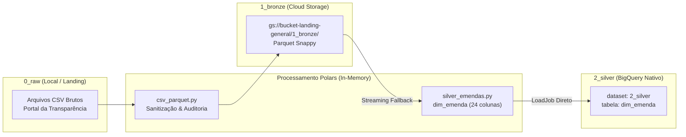

# Projeto de Análise de Emendas Parlamentares (ETL no GCP)


Pipeline de Engenharia de Dados de alta performance para extração, tratamento, enriquecimento e carga analítica dos dados abertos de **Emendas Parlamentares do Brasil**, utilizando a plataforma **Google Cloud Platform (GCP)** com processamento vetorizado em memória via **Polars**.

---

## 🎯 Objetivo

Construir um pipeline ETL/ELT robusto e resiliente seguindo o padrão **Medallion Architecture**:
1. **Raw (0_raw)**: Ingestão de dados brutos tabulares em formato CSV (`ISO-8859-1` / `UTF-8`).
2. **Bronze (1_bronze)**: Conversão para formato colunar Parquet em memória, sanitização de cabeçalhos (`snake_case`), injeção de metadados de auditoria (`_ingestion_timestamp` e `_source_file`) e arquivamento seguro no **Google Cloud Storage (GCS)**.
3. **Silver (2_silver)**: Modelagem dimensional analítica (`dim_emenda`), deduplicação por chave de negócio, tipagem forte (`Int64`), tratamento de códigos de sentinela (`MU` -> `null`, `Sem informação` -> `-1`, `Múltiplo` -> `-14`), enriquecimento geográfico contextual e carga direta em **tabelas nativas gerenciadas no BigQuery**.
4. **Gold (3_gold)**: Construção de tabelas fatos de execução orçamentária e data marts agregados para consumo em ferramentas de BI (Looker Studio, Power BI).

---

## 🏗️ Arquitetura de Dados



---

## ⚙️ Stack Tecnológica

- **Linguagem & Processamento:** Python 3.12, [Polars](https://pola.rs/) (processamento colunar vetorizado em memória), `pandas`.
- **Nuvem & Armazenamento (GCP):**
  - **Google Cloud Storage (GCS):** Data Lake Bronze (arquivos brutos otimizados em Parquet).
  - **Google BigQuery:** Data Warehouse analítico (tabelas nativas gerenciadas com particionamento).
- **Gerenciador de Ambientes & Pacotes:** [uv](https://docs.astral.sh/uv/) (execução rápida com lockfile reproduzível).
- **Linter & Formatador:** [Ruff](https://docs.astral.sh/ruff/) (padronização de código com limite de 120 caracteres).
- **Testes Automatizados:** [Pytest](https://pytest.org/) com mocks completos para APIs de nuvem.

---

## 📂 Estrutura do Projeto

```text
projeto_emendas/
├── .github/workflows/
│   └── ci_cd.yml                      # Pipeline de CI/CD (Ruff + Pytest)
├── pyproject.toml                     # Metadados, dependências, ruff e pytest configs
├── uv.lock                            # Lockfile reproduzível do uv
├── .env                               # Variáveis de ambiente (ignorado no git)
├── database/                          # Dados brutos CSV locais (Portal da Transparência)
├── database_sample/                   # Amostras reduzidas para execução de testes em CI
├── data/
│   ├── bronze/                        # Parquets intermediários gerados da camada Bronze
│   └── silver/                        # Parquets gerados da camada Silver (dim_emenda.parquet)
├── notebooks/
│   └── projeto_inicial.ipynb          # Explorações interativas e prototipação de regras
├── src/
│   └── etl_emendas_parlamentares/
│       ├── __init__.py
│       ├── pipeline.py                # Orquestração do pipeline ponta a ponta
│       ├── config/
│       │   └── config.py              # Definições de caminhos, datasets e prefixos
│       ├── conexao/
│       │   └── big_query.py           # Conexão autenticada ao BigQuery e Storage via Service Account
│       ├── ingestao/
│       │   ├── upload_bronze.py       # Ingestão de arquivos Parquet no GCS
│       │   └── upload_silver.py       # Carga direta em tabelas nativas gerenciadas no BigQuery
│       └── processamento/
│           ├── csv_parquet.py         # Conversão de CSV para Parquet com injeção de auditoria
│           ├── normalizar.py          # Normalização de nomes de colunas (snake_case)
│           └── silver_emendas.py      # Transformação, limpeza e enriquecimento de dim_emenda
└── tests/
    ├── conftest.py                    # Fixtures e configurações globais do Pytest
    ├── test_csv_parquet.py            # Testes de conversão CSV -> Parquet
    ├── test_normalizar.py             # Testes de sanitização de strings e colunas
    ├── test_pipeline.py               # Testes de orquestração do pipeline
    ├── test_silver_emendas.py         # Testes de regras de negócio e fallback da Silver
    ├── test_upload_bronze.py          # Testes de envio para o Cloud Storage
    └── test_upload_silver.py          # Testes de carga nativa no BigQuery
```

---

## 🔑 Variáveis de Ambiente (`.env`)

Crie um arquivo `.env` na raiz do projeto com as seguintes variáveis:

```dotenv
GCP_PROJECT_ID="seu-projeto-gcp-id"
GCS_BUCKET_NAME="gs://seu-bucket-landing"
GOOGLE_APPLICATION_CREDENTIALS="gcp-credentials.json"
```

> [!IMPORTANT]
> O arquivo `gcp-credentials.json` e o `.env` contêm credenciais confidenciais e estão configurados no `.gitignore` para nunca serem versionados.

---

## 🚀 Como Executar

### 1. Preparação do Ambiente Local com `uv`

1. Instale o [uv](https://docs.astral.sh/uv/):
   ```bash
   pip install uv
   # ou via winget (Windows): winget install astral-sh.uv
   ```
2. Instale as dependências e crie o ambiente virtual automaticamente:
   ```bash
   uv sync
   ```

### 2. Execução dos Testes e Validação de Código

- Rodar suíte de testes unitários:
  ```bash
  uv run pytest
  ```
- Rodar o linter:
  ```bash
  uv run ruff check .
  ```
- Verificar a formatação:
  ```bash
  uv run ruff format --check .
  ```

### 3. Execução do Pipeline

- **Executar Pipeline Completo (Raw -> Bronze -> Silver)**:
  ```bash
  uv run python src/etl_emendas_parlamentares/pipeline.py
  ```

- **Executar Módulos Individualmente**:
  - *Processar CSVs brutos para Parquet (Raw)*:
    ```bash
    uv run python src/etl_emendas_parlamentares/processamento/csv_parquet.py
    ```
  - *Enviar Parquets para a camada Bronze no Cloud Storage*:
    ```bash
    uv run python src/etl_emendas_parlamentares/ingestao/upload_bronze.py
    ```
  - *Processar a camada Silver (`dim_emenda`)*:
    ```bash
    uv run python src/etl_emendas_parlamentares/processamento/silver_emendas.py
    ```
  - *Carregar tabelas da Silver no BigQuery nativo*:
    ```bash
    uv run python src/etl_emendas_parlamentares/ingestao/upload_silver.py
    ```
