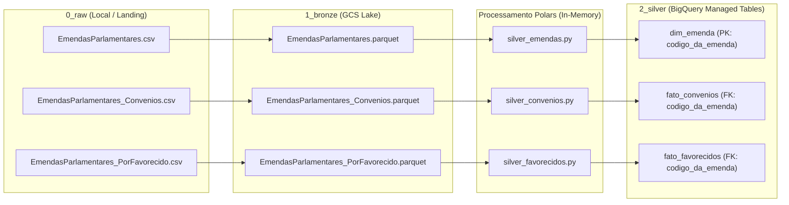

# Projeto de Análise de Emendas Parlamentares (ETL no GCP)


Pipeline de Engenharia de Dados de alta performance para extração, tratamento, enriquecimento e carga analítica dos dados abertos de **Emendas Parlamentares do Brasil**, utilizando a plataforma **Google Cloud Platform (GCP)** com processamento vetorizado em memória via **Polars**.

---

## 🎯 Objetivo

Construir um pipeline ETL/ELT robusto e resiliente seguindo o padrão **Medallion Architecture**:
1. **Raw (0_raw)**: Ingestão de dados brutos tabulares em formato CSV (`ISO-8859-1` / `UTF-8`).
2. **Bronze (1_bronze)**: Conversão para formato colunar Parquet em memória, sanitização de cabeçalhos (`snake_case`), injeção de metadados de auditoria (`_ingestion_timestamp` e `_source_file`) e arquivamento seguro no **Google Cloud Storage (GCS)**.
3. **Silver (2_silver)**: Modelagem dimensional analítica em padrão **Star Schema**, garantindo integridade referencial, tratamento de sentinelas, engenharia de atributos geográficos e temporais, e carga direta em **tabelas nativas gerenciadas no BigQuery**:
   - `dim_emenda`: Dimensão de emendas com autor, ano, classificação orçamentária (função/subfunção/programa/ação) e UF/município.
   - `fato_convenios`: Fato analítica tratando a relação $N:N$ entre emendas e instrumentos contratuais com valores alocados.
   - `fato_favorecidos`: Fato periódica mensal acumulada de transferências e pagamentos diretos por favorecido (CNPJ/CPF/Órgão).
4. **Gold (3_gold)**: Construção de data marts agregados com métricas orçamentárias (valores empenhados, liquidados e pagos por parlamentar e localidade) para consumo em BI e inteligência analítica.

---

## 🏗️ Arquitetura de Dados



---

## ⚙️ Stack Tecnológica

- **Linguagem & Processamento:** Python 3.12, [Polars](https://pola.rs/) (processamento colunar vetorizado em memória), `pandas`.
- **Nuvem & Armazenamento (GCP):**
  - **Google Cloud Storage (GCS):** Data Lake Bronze (arquivos brutos otimizados em Parquet Snappy).
  - **Google BigQuery:** Data Warehouse analítico (tabelas nativas gerenciadas na camada Silver).
- **Gerenciador de Ambientes & Pacotes:** [uv](https://docs.astral.sh/uv/) (execução rápida com lockfile reproduzível).
- **Linter & Formatador:** [Ruff](https://docs.astral.sh/ruff/) (padronização de código com limite de 120 caracteres).
- **Testes Automatizados:** [Pytest](https://pytest.org/) com mocks completos para APIs de nuvem (GCS e BigQuery).

---

## 📂 Estrutura do Projeto

```text
projeto_emendas/
├── .github/workflows/
│   └── ci_cd.yml                      # Pipeline de CI/CD (Ruff + Pytest)
├── pyproject.toml                     # Metadados, dependências, ruff e pytest configs
├── uv.lock                            # Lockfile reproduzível do uv
├── .env                               # Variáveis de ambiente (ignorado no git)
├── database/                          # Dados brutos CSV locais (Portal da Transparência)
├── database_sample/                   # Amostras reduzidas para execução de testes em CI
├── data/
│   ├── bronze/                        # Parquets intermediários gerados da camada Bronze
│   └── silver/                        # Parquets gerados da Silver (dim_emenda, fato_convenios, fato_favorecidos)
├── notebooks/
│   └── projeto_inicial.ipynb          # Explorações interativas e prototipação de regras
├── src/
│   └── etl_emendas_parlamentares/
│       ├── __init__.py
│       ├── pipeline.py                # Orquestração do pipeline ponta a ponta
│       ├── config/
│       │   └── config.py              # Definições de caminhos, datasets e prefixos
│       ├── conexao/
│       │   └── big_query.py           # Conexão autenticada ao BigQuery e Storage via Service Account
│       ├── ingestao/
│       │   ├── upload_bronze.py       # Ingestão de arquivos Parquet no GCS
│       │   └── upload_silver.py       # Carga direta em tabelas nativas gerenciadas no BigQuery
│       └── processamento/
│           ├── csv_parquet.py         # Conversão de CSV para Parquet com injeção de auditoria
│           ├── normalizar.py          # Normalização de nomes de colunas (snake_case)
│           ├── silver_emendas.py      # Transformação, limpeza e enriquecimento de dim_emenda
│           ├── silver_convenios.py    # Modelagem N:N da fato_convenios com tipagem monetária
│           └── silver_favorecidos.py  # Modelagem periódica da fato_favorecidos com datas mensais
└── tests/
    ├── conftest.py                    # Fixtures e configurações globais do Pytest
    ├── test_csv_parquet.py            # Testes de conversão CSV -> Parquet
    ├── test_normalizar.py             # Testes de sanitização de strings e colunas
    ├── test_pipeline.py               # Testes de orquestração do pipeline
    ├── test_silver_emendas.py         # Testes de regras de negócio e fallback de dim_emenda
    ├── test_silver_convenios.py       # Testes de regras N:N e tipagens de fato_convenios
    ├── test_silver_favorecidos.py     # Testes de regras temporais e métricas de fato_favorecidos
    ├── test_upload_bronze.py          # Testes de envio para o Cloud Storage
    └── test_upload_silver.py          # Testes de carga nativa no BigQuery
```

---

## 🔑 Variáveis de Ambiente (`.env`)

Crie um arquivo `.env` na raiz do projeto com as seguintes variáveis:

```dotenv
GCP_PROJECT_ID="seu-projeto-gcp-id"
GCS_BUCKET_NAME="gs://seu-bucket-landing"
GOOGLE_APPLICATION_CREDENTIALS="gcp-credentials.json"
```

> [!IMPORTANT]
> O arquivo `gcp-credentials.json` e o `.env` contêm credenciais confidenciais e estão configurados no `.gitignore` para nunca serem versionados.

---

## 🚀 Como Executar

### 1. Preparação do Ambiente Local com `uv`

1. Instale o [uv](https://docs.astral.sh/uv/):
   ```bash
   pip install uv
   # ou via winget (Windows): winget install astral-sh.uv
   ```
2. Instale as dependências e crie o ambiente virtual automaticamente:
   ```bash
   uv sync
   ```

### 2. Execução dos Testes e Validação de Código

- Rodar suíte completa de testes unitários (35 testes):
  ```bash
  uv run pytest
  ```
- Rodar o linter:
  ```bash
  uv run ruff check .
  ```
- Verificar a formatação:
  ```bash
  uv run ruff format --check .
  ```

### 3. Execução do Pipeline

- **Executar Pipeline Completo (Raw -> Bronze -> Silver)**:
  ```bash
  uv run python src/etl_emendas_parlamentares/pipeline.py
  ```

- **Executar Módulos Individualmente**:
  - *Processar CSVs brutos para Parquet (Raw)*:
    ```bash
    uv run python src/etl_emendas_parlamentares/processamento/csv_parquet.py
    ```
  - *Enviar Parquets para a camada Bronze no Cloud Storage*:
    ```bash
    uv run python src/etl_emendas_parlamentares/ingestao/upload_bronze.py
    ```
  - *Processar dimensão de emendas (`dim_emenda`)*:
    ```bash
    uv run python src/etl_emendas_parlamentares/processamento/silver_emendas.py
    ```
  - *Processar fato de convênios (`fato_convenios`)*:
    ```bash
    uv run python src/etl_emendas_parlamentares/processamento/silver_convenios.py
    ```
  - *Processar fato de favorecidos (`fato_favorecidos`)*:
    ```bash
    uv run python src/etl_emendas_parlamentares/processamento/silver_favorecidos.py
    ```
  - *Carregar todas as tabelas da Silver no BigQuery nativo*:
    ```bash
    uv run python src/etl_emendas_parlamentares/ingestao/upload_silver.py
    ```

---

## 🗺️ Roadmap de Evolução

O projeto segue um plano de evolução estruturado para expandir a maturidade analítica e incorporar capacidades avançadas de Inteligência Artificial:

- [x] **Camada Bronze (1_bronze):** Ingestão, auditoria e arquivamento colunar Parquet no Google Cloud Storage (GCS).
- [x] **Camada Silver (2_silver):** Modelagem dimensional Star Schema completa (`dim_emenda`, `fato_convenios` e `fato_favorecidos`) com carga direta em tabelas nativas gerenciadas no BigQuery.
- [ ] **Camada Gold (3_gold):** Construção de data marts agregados com métricas orçamentárias (valores empenhados, liquidados, pagos e restos a pagar por município/função).
- [ ] **Camada de Consumo Inteligente (Google Cloud Vertex AI):**
  - **Agentes de IA & Text-to-SQL (Gemini no Vertex AI):** Interface conversacional em linguagem natural para permitir consultas intuitivas aos dados de emendas, convênios e execuções orçamentárias sem necessidade de queries SQL manuais.
  - **Detecção de Anomalias & Machine Learning:** Modelos preditivos para identificar padrões atípicos na distribuição de recursos e prazos de liquidação de convênios.
  - **Busca Semântica & RAG (Retrieval-Augmented Generation):** Indexação vetorial de objetos e descrições de convênios no Vertex AI Vector Search para análises textuais aprofundadas e fiscalização temática automatizada.
- [ ] **Visualização Analítica:** Dashboards executivos e operacionais conectados via Looker Studio / Power BI.
