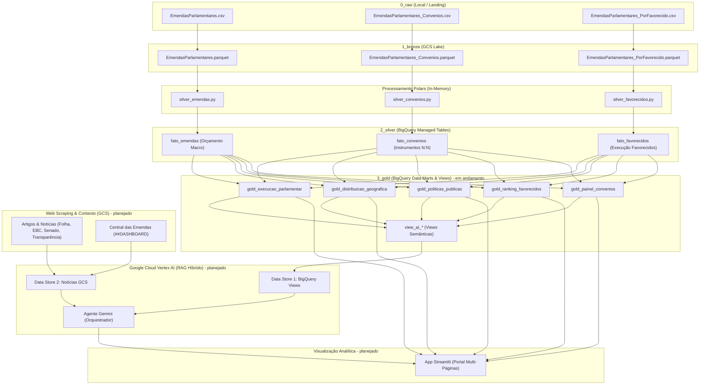

# Projeto de Análise de Emendas Parlamentares (ETL no GCP)


Pipeline de Engenharia de Dados para extração, tratamento e carga analítica dos dados abertos de **Emendas Parlamentares do Brasil**, utilizando a plataforma **Google Cloud Platform (GCP)** com processamento colunar em memória via **Polars**.

> **Status atual:** camadas **Raw, Bronze e Silver (fatos)** implementadas e executando de ponta a ponta em ~2 minutos. **Gold, scraping, RAG com Gemini e dashboards Streamlit estão em desenvolvimento** (veja o [Roadmap](#️-roadmap-de-evolução) e a tabela de [Decisões de Projeto](#-decisões-de-projeto-e-status)).

---

## 🎯 Objetivo

Construir um pipeline ETL/ELT seguindo o padrão **Medallion Architecture**:
1. **Raw (0_raw)**: Ingestão de dados brutos tabulares em formato CSV (`ISO-8859-1` / `UTF-8`).
2. **Bronze (1_bronze)**: Conversão para formato colunar Parquet em memória, sanitização de cabeçalhos (`snake_case`), injeção de metadados de auditoria (`_ingestion_timestamp` e `_source_file`) e arquivamento no **Google Cloud Storage (GCS)**.
3. **Silver (2_silver)**: Modelagem analítica em tabelas fato, com descarte de registros nulos ou vazios, mapeamento de sentinelas (regra de tratamento em estudo), engenharia de atributos geográficos e temporais, e carga direta em **tabelas nativas gerenciadas no BigQuery**. As dimensões (autor, localidade, função) estão planejadas e serão criadas conforme a necessidade de consumo:
   - `fato_emendas`: Fato orçamentária consolidando dotações das emendas com 6 métricas monetárias (empenhado, liquidado, pago, restos a pagar inscritos/cancelados/pagos), autor, ano, classificação funcional e localização.
   - `fato_convenios`: Fato analítica tratando a relação $N:N$ entre emendas e instrumentos contratuais com valores alocados (granularidade e deduplicação a definir na Gold).
   - `fato_favorecidos`: Fato periódica mensal de transferências e pagamentos diretos por favorecido (CNPJ/CPF/Órgão).
4. **Gold (3_gold)** *(em andamento)*: Data Marts analíticos em SQL materializados no **Google BigQuery** e camada de **Views Semânticas** preparadas para consumo analítico e inteligência artificial.
5. **Web Scraping & Contexto Não-Estruturado** *(planejado)*: Ingestão de artigos, notícias e observatórios cívicos para enriquecimento qualitativo das análises.
6. **Consumo Inteligente & Visualização** *(planejado)*: Agente conversacional Gemini com RAG Híbrido no **Google Cloud Vertex AI** e portal analítico interativo em **Streamlit**.

---

## 🏗️ Arquitetura de Dados



---

## 🧭 Decisões de Projeto e Status

| Tema | Decisão | Status |
|---|---|---|
| Processamento | Polars, pelo baixo uso de computação nas transformações brutas. Não houve benchmark formal contra pandas ou PySpark. | Implementado |
| Volume e tempo | CSVs convertidos em Parquet de ~20 MB em média; pipeline completo em ~2 minutos. | Medido |
| Bronze | Parquet (Snappy) arquivado no GCS: o bruto fica isolado do consumo externo, a baixo custo. | Implementado |
| Silver | Tabelas nativas no BigQuery, com ingestão direta e foco em custo reduzido. | Implementado |
| Qualidade | Emendas com código nulo ou vazio são descartadas na Silver (~8% a 18% da base bruta, conforme a entidade). | Parcial: sem reconciliação de linhas entre camadas |
| Sentinelas | Valores especiais já mapeados; regra de tratamento ainda em estudo. | Em estudo |
| Modelagem | Fatos tratadas e validadas previamente; dimensões (autor, localidade, função) serão criadas se o consumo exigir. | Planejado |
| Convênios (N:N) | Deduplicação com `QUALIFY` na Gold, após a exploração dos dados. | Planejado |
| Favorecidos | Granularidade mensal, pois o valor empenhado pode ser pago ao longo de vários meses. | Implementado |
| Carga | Hoje sobrescreve as tabelas (dados fixos, execução rápida). Com os dados semestrais, a ideia é migrar para MERGE incremental, após verificar se os arquivos antigos mudam a cada semestre. | Planejado |
| Testes | 35 testes com mocks de GCS e BigQuery cobrindo o fluxo; testes de regra de negócio virão com as agregações da Gold. | Parcial |
| Gold | Cada Data Mart responde a uma pergunta de negócio (empenhado, pago, UF, parlamentar). | Em andamento |
| RAG híbrido | Dados oficiais do BigQuery como base, com artigos e notícias como contexto complementar. Custo de BigQuery e Vertex AI ainda não estimado. | Planejado |
| GCP vs. Databricks | O projeto nasceu no Databricks (versão gratuita) e foi refeito no GCP para medir custo e esforço reais, e para testar execução híbrida: pipeline local, empacotável em Docker, com custo só de armazenamento e Vertex. | Decisão tomada |

---

## ⚙️ Stack Tecnológica

- **Linguagem & Processamento:** Python 3.12, [Polars](https://pola.rs/) (processamento colunar em memória).
- **Nuvem & Armazenamento (GCP):**
  - **Google Cloud Storage (GCS):** Data Lake Bronze (arquivos em Parquet Snappy).
  - **Google BigQuery:** Data Warehouse analítico (tabelas nativas gerenciadas na camada Silver).
- **Gerenciador de Ambientes & Pacotes:** [uv](https://docs.astral.sh/uv/) (lockfile reproduzível).
- **Linter & Formatador:** [Ruff](https://docs.astral.sh/ruff/) (limite de 120 caracteres).
- **Testes Automatizados:** [Pytest](https://pytest.org/) com mocks para APIs de nuvem (GCS e BigQuery).

---

## 📂 Estrutura do Projeto

```text
projeto_emendas/
├── .github/workflows/
│   └── ci_cd.yml                      # Pipeline de CI/CD (Ruff + Pytest)
├── pyproject.toml                     # Metadados, dependências, ruff e pytest configs
├── uv.lock                            # Lockfile reproduzível do uv
├── .env                               # Variáveis de ambiente (ignorado no git)
├── app/                               # Aplicação Web Streamlit (Multi-páginas, em desenvolvimento)
│   ├── Home.py                        # Ponto de entrada e visão geral do portal
│   └── pages/
│       ├── 1_📊_Visao_Geral.py        # KPIs macro e métricas orçamentárias
│       ├── 2_🏛️_Parlamentares.py       # Raio-X por deputado e senador
│       ├── 3_🗺️_Mapa_Brasil.py         # Distribuição geográfica e municipal
│       ├── 4_🏢_Beneficiarios.py       # Maiores recebedores e fornecedores
│       └── 5_🤖_Assistente_IA.py       # Chatbot interativo com Gemini (Vertex AI)
├── database/                          # Dados brutos CSV locais (Portal da Transparência)
├── database_sample/                   # Amostras reduzidas para execução de testes em CI
├── data/
│   ├── bronze/                        # Parquets intermediários gerados da camada Bronze
│   ├── silver/                        # Parquets gerados da Silver (fato_emendas, fato_convenios, fato_favorecidos)
│   └── gold/                          # Diretório reservado para artefatos compilados da Gold
├── sql/
│   └── gold/                          # Scripts SQL dos Data Marts (em desenvolvimento)
│       ├── gold_execucao_parlamentar.sql
│       ├── gold_distribuicao_geografica.sql
│       ├── gold_politicas_publicas.sql
│       ├── gold_ranking_favorecidos.sql
│       └── gold_painel_convenios.sql
├── notebooks/
│   └── projeto_inicial.ipynb          # Explorações interativas e prototipação de regras
├── src/
│   └── etl_emendas_parlamentares/
│       ├── __init__.py
│       ├── pipeline.py                # Orquestração do pipeline ponta a ponta
│       ├── config/
│       │   └── config.py              # Definições de caminhos, datasets e prefixos
│       ├── conexao/
│       │   └── big_query.py           # Conexão autenticada ao BigQuery e Storage via Service Account
│       ├── ingestao/
│       │   ├── upload_bronze.py       # Ingestão de arquivos Parquet no GCS
│       │   └── upload_silver.py       # Carga direta em tabelas nativas gerenciadas no BigQuery
│       ├── processamento/
│       │   ├── csv_parquet.py         # Conversão de CSV para Parquet com injeção de auditoria
│       │   ├── normalizar.py          # Normalização de nomes de colunas (snake_case)
│       │   ├── silver_emendas.py      # Modelagem da fato_emendas com métricas orçamentárias
│       │   ├── silver_convenios.py    # Modelagem N:N da fato_convenios com tipagem monetária
│       │   └── silver_favorecidos.py  # Modelagem periódica da fato_favorecidos com datas mensais
│       └── scraping/
│           ├── __init__.py
│           └── fontes.py              # Mapeamento das fontes de notícias e observatórios
└── tests/
    ├── conftest.py                    # Fixtures e configurações globais do Pytest
    ├── test_csv_parquet.py            # Testes de conversão CSV -> Parquet
    ├── test_normalizar.py             # Testes de sanitização de strings e colunas
    ├── test_pipeline.py               # Testes de orquestração do pipeline
    ├── test_silver_emendas.py         # Testes da transformação de fato_emendas
    ├── test_silver_convenios.py       # Testes da transformação de fato_convenios
    ├── test_silver_favorecidos.py     # Testes da transformação de fato_favorecidos
    ├── test_upload_bronze.py          # Testes de envio para o Cloud Storage
    └── test_upload_silver.py          # Testes de carga nativa no BigQuery
```

---

## 🔑 Variáveis de Ambiente (`.env`)

Crie um arquivo `.env` na raiz do projeto com as seguintes variáveis:

```dotenv
GCP_PROJECT_ID="seu-projeto-gcp-id"
GCS_BUCKET_NAME="gs://seu-bucket-landing"
GOOGLE_APPLICATION_CREDENTIALS="gcp-credentials.json"
```

> [!IMPORTANT]
> O arquivo `gcp-credentials.json` e o `.env` contêm credenciais confidenciais e estão configurados no `.gitignore` para nunca serem versionados.

---

## 🚀 Como Executar

### 1. Preparação do Ambiente Local com `uv`

1. Instale o [uv](https://docs.astral.sh/uv/):
   ```bash
   pip install uv
   # ou via winget (Windows): winget install astral-sh.uv
   ```
2. Instale as dependências e crie o ambiente virtual automaticamente:
   ```bash
   uv sync
   ```

### 2. Execução dos Testes e Validação de Código

- Rodar suíte completa de testes unitários (35 testes):
  ```bash
  uv run pytest
  ```
- Rodar o linter:
  ```bash
  uv run ruff check .
  ```
- Verificar a formatação:
  ```bash
  uv run ruff format --check .
  ```

### 3. Execução do Pipeline

- **Executar Pipeline Completo (Raw -> Bronze -> Silver)**:
  ```bash
  uv run python src/etl_emendas_parlamentares/pipeline.py
  ```

- **Executar Módulos Individualmente**:
  - *Processar CSVs brutos para Parquet (Raw)*:
    ```bash
    uv run python src/etl_emendas_parlamentares/processamento/csv_parquet.py
    ```
  - *Enviar Parquets para a camada Bronze no Cloud Storage*:
    ```bash
    uv run python src/etl_emendas_parlamentares/ingestao/upload_bronze.py
    ```
  - *Processar fato de emendas orçamentárias (`fato_emendas`)*:
    ```bash
    uv run python src/etl_emendas_parlamentares/processamento/silver_emendas.py
    ```
  - *Processar fato de convênios (`fato_convenios`)*:
    ```bash
    uv run python src/etl_emendas_parlamentares/processamento/silver_convenios.py
    ```
  - *Processar fato de favorecidos (`fato_favorecidos`)*:
    ```bash
    uv run python src/etl_emendas_parlamentares/processamento/silver_favorecidos.py
    ```
  - *Carregar todas as tabelas da Silver no BigQuery nativo*:
    ```bash
    uv run python src/etl_emendas_parlamentares/ingestao/upload_silver.py
    ```

---

## 🗺️ Roadmap de Evolução

- [x] **Camada Bronze (1_bronze):** Ingestão, auditoria e arquivamento colunar Parquet no Google Cloud Storage (GCS).
- [x] **Camada Silver (2_silver) - fatos:** `fato_emendas`, `fato_convenios` e `fato_favorecidos` carregadas como tabelas nativas no BigQuery.
  - [ ] Tratamento de sentinelas (valores já mapeados, regra em estudo).
  - [ ] Dimensões (autor, localidade, função), conforme necessidade de consumo.
  - [ ] Reconciliação de contagem de linhas entre camadas (Raw → Bronze → Silver).
  - [ ] Carga incremental com MERGE (definir chave natural e fallback na virada de semestre).
- [ ] **Camada Gold (3_gold - Em Andamento):**
  - [x] Definição arquitetural dos Data Marts via SQL padronizado no BigQuery.
  - [ ] Implementação e validação dos scripts analíticos em `sql/gold/`:
    - `gold_execucao_parlamentar.sql` (visão parlamentar e taxas de execução)
    - `gold_distribuicao_geografica.sql` (visão territorial por UF e municípios)
    - `gold_politicas_publicas.sql` (visão setorial por função e subfunção)
    - `gold_ranking_favorecidos.sql` (maiores fornecedores, ONGs e entidades)
    - `gold_painel_convenios.sql` (descentralização e instrumentos federais)
  - [ ] Testes de regra de negócio sobre as agregações monetárias.
  - [ ] Camada de Views Semânticas de Consumo com metadados para IA (`view_ai_*`).
- [ ] **Camada de Web Scraping & Contexto Não-Estruturado:**
  - [x] Mapeamento das 6 fontes (Folha de S.Paulo, Agência Brasil/EBC, Agência Senado, Central das Emendas, Portal da Transparência, Transparência Brasil).
  - [ ] Esteira de scraping para captura de notícias e armazenamento em `gs://.../raw/scraping/`.
- [ ] **Camada de Consumo Inteligente (Google Cloud Vertex AI):**
  - [ ] Estimativa de custo (BigQuery e Vertex AI).
  - [ ] RAG Híbrido no **Vertex AI Agent Builder** integrando BigQuery (dados oficiais auditáveis) e Cloud Storage (artigos e notícias de contexto).
  - [ ] **Agente Gemini:** Interface conversacional em linguagem natural com citações de fontes.
- [ ] **Visualização Analítica Interativa (Streamlit Web App):**
  - [x] Estrutura base multi-páginas configurada em `app/`.
  - [ ] Desenvolvimento dos dashboards interativos (Visão Geral, Parlamentares, Mapa Brasil, Beneficiários).
  - [ ] Integração do chat interativo com o Agente do Vertex AI (`app/pages/5_🤖_Assistente_IA.py`).
- [ ] **Empacotamento:** Imagem Docker do pipeline para execução híbrida (local ou no GCP).