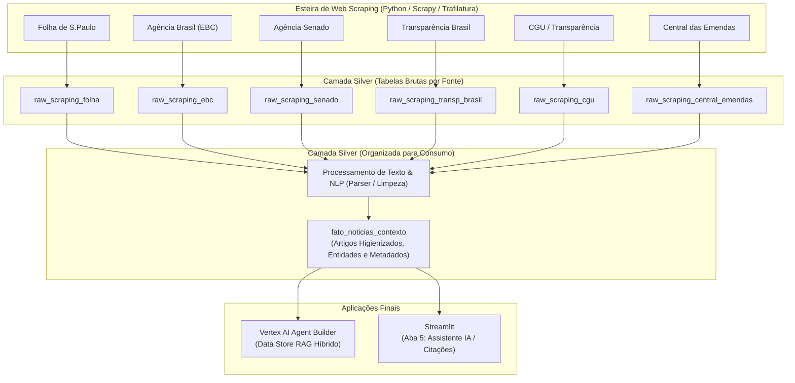

# 🌐 Plano de Implementação — Web Scraping & Contexto Qualitativo
## Ingestão de Notícias, Observatórios e Artigos na Camada Silver

Este documento estabelece o roteiro técnico de arquitetura e implementação para a esteira de **Web Scraping** do projeto. O objetivo é enriquecer os dados orçamentários oficiais (SIAFI/CGU) com apurações jornalísticas, notas técnicas, decisões judiciais e análises de observatórios cívicos, estruturando as informações na **Camada Silver** do BigQuery para consumo pelo **Streamlit** e pelo **Agente Gemini (Vertex AI)**.

---

## 🏗️ 1. Arquitetura de Dados do Scraping

Conforme diretriz do projeto, a coleta operará em duas etapas dentro do ambiente **Silver**:
1. **Landing Bruta por Fonte (`2_silver.raw_scraping_<fonte>`):** Cada resposta de coleta/requisição é persistida de forma bruta (payload HTML/JSON íntegro com metadados de requisição) em uma tabela dedicada por fonte.
2. **Organização e Consumo na Silver (`2_silver.fato_noticias_contexto`):** Pipeline interno de processamento que lê as tabelas brutas, extrai o texto higienizado, remove scripts/marcações, indexa entidades (parlamentares, partidos, UFs) e consolida os artigos em uma tabela analítica única.



---

## 🎯 2. Mapeamento das 6 Fontes Oficiais

As fontes mapeadas no arquivo `src/etl_emendas_parlamentares/scraping/fontes.py` cobrem diferentes dimensões do ecossistema de emendas:

| # | Fonte | URL Base de Coleta | Tipo de Conteúdo | Foco Analítico |
|---|---|---|---|---|
| **1** | **Folha de S.Paulo** | `https://www1.folha.uol.com.br/folha-topicos/emenda-parlamentar/` | Jornalismo Investigativo | Decisões do STF, Emendas de Relator (RP9), apurações de desvios e impacto fiscal |
| **2** | **Agência Brasil (EBC)** | `https://agenciabrasil.ebc.com.br/tags/emendas-parlamentares-0` | Noticiário Oficial | Decretos federais, cronogramas de pagamento do Executivo e liberações orçamentárias |
| **3** | **Agência Senado** | `https://www12.senado.leg.br/noticias/destaques/emendas-parlamentares/pag/1` | Noticiário Legislativo | Tramitação de PECs, debates no Congresso, discursos e prestação de contas |
| **4** | **Transparência Brasil** | `https://www.transparencia.org.br/noticias/` | Auditoria Cívica | Estudos de rastreabilidade, notas técnicas sobre Emendas PIX e controle social |
| **5** | **Portal da Transparência (CGU)** | `https://portaldatransparencia.gov.br/emendas` | Normas & Regras Técnicas | Manuais operacionais, portarias interministeriais e diretrizes de prestação de contas |
| **6** | **Central das Emendas** | `https://www.centraldasemendas.info/dados` | Observatório Cívico | Painéis analíticos e relatórios de monitoramento legislativo |

---

## 🗄️ 3. Modelagem de Dados no BigQuery

### 3.1. Tabelas Brutas na Silver (`2_silver.raw_scraping_<fonte>`)
Cada fonte possuirá sua própria tabela bruta com histórico cumulativo e preservação do payload original.

**Campos da Tabela Bruta:**
```sql
CREATE TABLE IF NOT EXISTS `{PROJECT_ID}.2_silver.raw_scraping_folha` (
    id_requisicao STRING NOT NULL OPTIONS(description="UUID único da requisição"),
    url_artigo STRING NOT NULL OPTIONS(description="URL canônica do artigo coletado"),
    nome_fonte STRING NOT NULL OPTIONS(description="Identificador da fonte (ex: folha)"),
    dh_coleta TIMESTAMP NOT NULL OPTIONS(description="Data e hora exata da raspagem (UTC)"),
    http_status INT64 NOT NULL OPTIONS(description="Código HTTP retornado (ex: 200, 301)"),
    payload_bruto STRING NOT NULL OPTIONS(description="HTML ou JSON íntegro retornado pela página"),
    hash_conteudo STRING NOT NULL OPTIONS(description="Hash SHA-256 do payload para idempotência")
)
CLUSTER BY dh_coleta, url_artigo;
```

---

### 3.2. Tabela Organizada para Consumo na Silver (`2_silver.fato_noticias_contexto`)
Tabela analítica consolidando todas as fontes, com texto limpo, deduplicação e atributos preparados para busca vetorial e RAG.

**Schema da Tabela Consolidada:**

| Coluna | Tipo | Descrição |
|---|:---:|---|
| **`id_artigo`** | `STRING` | Hash SHA-256 único baseado na URL canônica |
| **`nome_fonte`** | `STRING` | Nome amigável da fonte (`Folha de S.Paulo`, `EBC`, `Senado`, etc.) |
| **`url_artigo`** | `STRING` | Link público do artigo |
| **`titulo`** | `STRING` | Título / Manchete da publicação |
| **`subtitulo`** | `STRING` | Linha-fina ou resumo introdutório |
| **`autor`** | `STRING` | Nome do jornalista, repórter ou órgão autor |
| **`data_publicacao`** | `DATE` | Data em que a notícia foi publicada |
| **`dh_publicacao`** | `TIMESTAMP` | Timestamp completo de publicação |
| **`conteudo_texto`** | `STRING` | Texto integral limpo (sem tags HTML, scripts ou anúncios) |
| **`lead_resumo`** | `STRING` | Primeiros parágrafos estruturados para síntese rápida |
| **`tags`** | `ARRAY<STRING>` | Palavras-chave associadas pela fonte |
| **`parlamentares_mencionados`** | `ARRAY<STRING>` | Lista de nomes de parlamentares identificados no texto |
| **`ufs_mencionadas`** | `ARRAY<STRING>` | Siglas de UFs citadas no artigo |
| **`qtd_palavras`** | `INT64` | Contagem de palavras do corpo do texto |
| **`dh_processamento`** | `TIMESTAMP` | Timestamp do parsing e carga na Silver |

**DDL de Criação:**
```sql
CREATE TABLE IF NOT EXISTS `{PROJECT_ID}.2_silver.fato_noticias_contexto` (
    id_artigo STRING NOT NULL,
    nome_fonte STRING NOT NULL,
    url_artigo STRING NOT NULL,
    titulo STRING NOT NULL,
    subtitulo STRING,
    autor STRING,
    data_publicacao DATE,
    dh_publicacao TIMESTAMP,
    conteudo_texto STRING NOT NULL,
    lead_resumo STRING,
    tags ARRAY<STRING>,
    parlamentares_mencionados ARRAY<STRING>,
    ufs_mencionadas ARRAY<STRING>,
    qtd_palavras INT64,
    dh_processamento TIMESTAMP NOT NULL
)
CLUSTER BY data_publicacao, nome_fonte;
```

---

## 🛠️ 4. Estrutura Modular de Código (`src/.../scraping/`)

A esteira será implementada dentro da pasta já existente no projeto:

```text
src/etl_emendas_parlamentares/scraping/
├── __init__.py
├── fontes.py                 # Catálogo e configurações de URLs e seletores
├── client.py                 # Client HTTP com rotação de headers, timeout e retry
├── spiders/                  # Módulos coletores específicos por fonte
│   ├── __init__.py
│   ├── spider_folha.py       # Crawler da Folha de S.Paulo
│   ├── spider_ebc.py         # Crawler da Agência Brasil / EBC
│   ├── spider_senado.py      # Crawler da Agência Senado
│   ├── spider_transp_brasil.py # Crawler da Transparência Brasil
│   └── spider_cgu.py         # Crawler do Portal da Transparência
├── parser.py                 # Extração limpa com Trafilatura/BeautifulSoup e NER básico
├── carga_silver_raw.py       # Ingestão do payload bruto nas tabelas raw_scraping_*
├── processar_contexto.py     # Transformação das brutas para fato_noticias_contexto
└── pipeline_scraping.py      # Orquestrador geral da esteira de scraping
```

---

## ⚙️ 5. Tecnologias & Bibliotecas Selecionadas

Para assegurar eficiência, baixa latência e respeito às diretrizes de scraping:

1. **`httpx`:** Cliente HTTP assíncrono e síncrono moderno com suporte a HTTP/2.
2. **`trafilatura`:** Biblioteca de ponta para extração de texto principal de notícias web, removendo automaticamente *boilerplate*, cabeçalhos, menus e rodapés de sites jornalísticos.
3. **`beautifulsoup4`:** Parser HTML auxiliar para extração pontual de metadados (`<meta property="og:title">`, data em tags `<time>`, etc.).
4. **`tenacity`:** Resiliência com retries automáticos e *exponential backoff* em caso de instabilidade de rede ou rate-limiting temporário.

---

## 🛡️ 6. Políticas de Ética, Idempotência e Resiliência

* **Controle de Idempotência:** Antes de inserir uma requisição na tabela bruta, calcula-se o hash `SHA-256(url_artigo + payload_bruto)`. Se a URL e o conteúdo já existirem no BigQuery com coleta recente, a raspagem repetida é ignorada.
* **Headers Éticos:** Envio de `User-Agent` institucional identificável (ex.: `EmendasParlamentaresBot/1.0 (+transparencia.cgu)`).
* **Rate Limiting Cortês:** Pausa controlada (`time.sleep` entre 1 e 2 segundos) entre requisições para evitar sobrecarga nos servidores das fontes públicas e jornalísticas.

---

## 📋 7. Checklist de Implementação

### Fase 1: Fundação & Dependências
- [ ] Adicionar dependências ao projeto: `uv add httpx trafilatura beautifulsoup4 tenacity`.
- [ ] Criar no BigQuery o conjunto de tabelas brutas:
  - `2_silver.raw_scraping_folha`
  - `2_silver.raw_scraping_ebc`
  - `2_silver.raw_scraping_senado`
  - `2_silver.raw_scraping_transp_brasil`
  - `2_silver.raw_scraping_cgu`
- [ ] Criar a tabela analítica `2_silver.fato_noticias_contexto`.

### Fase 2: Implementação dos Coletores (`spiders/`)
- [ ] Implementar `client.py` com gerenciamento de sessão, headers e retries.
- [ ] Implementar os spiders individuais para paginação e extração das listagens de notícias:
  - Folha de S.Paulo (`spider_folha.py`)
  - Agência Brasil (`spider_ebc.py`)
  - Agência Senado (`spider_senado.py`)
  - Transparência Brasil (`spider_transp_brasil.py`)
- [ ] Implementar a ingestão dos dados brutos nas tabelas `raw_scraping_*` via BigQuery Streaming ou Load Jobs.

### Fase 3: Parser, Higienização e Carga Analítica
- [ ] Implementar `parser.py` utilizando `trafilatura` para extrair texto limpo, título e data de publicação.
- [ ] Desenvolver heurística de mapeamento de entidades (detecção de deputados, senadores e UFs mencionadas no texto).
- [ ] Implementar `processar_contexto.py` para ler das tabelas brutas e materializar a tabela `fato_noticias_contexto`.

### Fase 4: Integração com Pipeline Geral e IA
- [ ] Criar runner `pipeline_scraping.py` com logs estruturados de execução.
- [ ] Conectar a tabela `fato_noticias_contexto` à página do Streamlit (`5_🤖_Assistente_IA.py`) para citações com links clicáveis.
- [ ] Configurar a ingestão contínua como Data Store no **Vertex AI Agent Builder**.

### Fase 5: Testes Unitários & Validação
- [ ] Criar testes unitários com HTML mocks em `tests/test_scraping.py`.
- [ ] Validar conformidade de código com `uv run ruff check .` e `uv run pytest`.
- [ ] Executar carga de homologação inicial e validar a volumetria no BigQuery.

